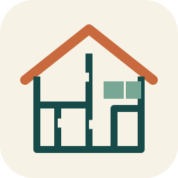

# CWS Architecture



CWS Architecture helps architects turn Vietnamese-language briefs, supplied sketches, and design feedback into reviewable architectural workflows. It preserves the designer's constraints, compares alternatives from the same baseline, and distinguishes proposals, measured checks, native edits, and saved files.

## What you can ask

- “Tôi có nhà 5 x 20 m, giữ cầu thang, đề xuất cách làm bếp thoáng hơn.”
- “Đọc ảnh phác tay này và tách phần chắc chắn khỏi phần cần hỏi lại.”
- “Kiểm cửa theo Lỗ Ban; tôi không biết chọn loại thước nào.”
- “Kiểm tra CWS đã kết nối được phần mềm thiết kế của tôi chưa.”

The plugin avoids asking ordinary customers to choose technical Lo Ban ruler profiles. Cultural checks are optional, use verified sources when available, and do not override safety or building requirements. The package does not bundle a validated Lo Ban lookup table.

## Connection and limits

The plugin declares one HTTPS MCP connection to the CWS Architecture service. Claude may ask you to enable or authenticate the connector. Never paste access tokens or API keys into a conversation. Use the supported CWS connection flow when available.

For Claude Code 2.1.275 or later, install from the publisher's marketplace:

```text
/plugin install cws-architecture --marketplace trankhanhduy1508-maker/cws-architecture-plugin
```

This publisher-managed installation is separate from approval and listing in Anthropic's directory.

Revit, AutoCAD, SketchUp, Rhino, Grasshopper, and Blender are conditional host integrations. Installing this plugin does not install or pair a local CAD bridge. Before editing, CWS must verify the actual runtime, user permissions, target application, document, and revision. If the bridge is unavailable, the plugin can help with briefs and proposals while clearly identifying the execution limit. It does not certify regulatory compliance or issue construction permits.

In Claude Code, a developer can test this folder locally with `claude --plugin-dir ./cws-architecture` and inspect the connection with `/mcp`. This is a development path, not proof of directory approval or native CAD execution. Use Anthropic's directory installation flow after the listing is approved and published.

The plugin does not provide a community training service or durable preference database. It uses only the context and authorized integrations actually available in the current session. Separate permission and a real storage capability are required for durable memory or community sharing.

## Publisher and support

Publisher: TRAN KHANH DUY. See the [product page](https://cws-lab-frontend.onrender.com/architecture/), [support](https://cws-lab-frontend.onrender.com/architecture/support/), [privacy policy](https://cws-lab-frontend.onrender.com/architecture/privacy/), and [service terms](https://cws-lab-frontend.onrender.com/architecture/terms/). This package is a CWS product; it does not claim Anthropic endorsement.
